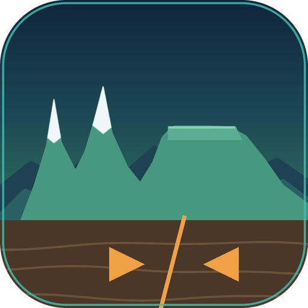

# Terrain Recast

<p align="center"></p>

> 用「板块构造 → 大地貌 → 气候 → 高度」的因果链重写主世界地形的 Fabric 模组。
> A Fabric mod that rebuilds overworld terrain from a plate-tectonics driven causal pipeline.
> English: [README.en.md](README.en.md)

[](https://www.minecraft.net/)
[](https://fabricmc.net/)
[](https://adoptium.net/)
[](LICENSE)

---

## 这是什么

Terrain Recast 用自定义密度函数接管原版主世界地形，地形不再是「柏林噪声堆高度」，而是：

```
板块（Worley 软 Voronoi）
  → 大陆度 / 板块边界接近度
  → 造山带与山墙 / 海沟 / 高原 / 盆地 / 裂谷
  → 侵蚀包络（锐利新山 vs 圆润老山）
  → 解析高度场 → 密度函数 → 真实方块地形
```

所有高度来自一个**连续场**：不读板块身份（避免 Voronoi 直边造成的上百格垂直断崖），
山峰可达 **Y≈1500**（默认配置下多种子实测 1200–1700），并支持原版 2544 格高的世界。

## 特性

- **板块地形**：软 Voronoi 板块 + F2−F1 边界距离场，边界处成山、洋侧成沟
- **两种山脉形态**：瘦山（`edge⁶ × ridge³`，阿尔卑斯式刃脊）与胖山（低频山块，高原式山体）
- **雪线模型**：海拔降温分两段——雪线以下极缓、雪线以上陡降；雪线随纬度与干旱度浮动（约 980±480 格），干旱区高山常年无雪、走裸岩（`stony_peaks`），湿润区才有雪顶
- **方山台地**：大尺度噪声划出方山区，区内高过 900 格的山削成 82% 高度的近平顶面（残余坡度 5%），形成带陡坎的方山／tepui；区外山体保持尖峰
- **喜马拉雅式山墙**：汇聚边界上用低频脊线连成连续长墙，而不是一串孤立圆锥
- **六类大地貌**：平原 / 丘陵 / 高原（带陡坎）/ 盆地（平坦盆底）/ 裂谷 / 山墙，按板块与纬度分布
- **出生点保护**：出生点 900 格内强制压平为平原，不会「一出生就在山上」
- **真实地表**：自定义 `material_rule`，按海拔、温度、坡度铺设表层方块
- **命令与预设**：定位高峰、查看脚下地形、导入导出调参预设
- **开放 API**：数据修改器、地物注入、矿床注册、事件总线（见 [API 指南](api-guide/README.md)）

## 环境要求

| 项目 | 版本 |
|---|---|
| Minecraft | 26.3 |
| Fabric Loader | ≥ 0.20.1 |
| Fabric API | 0.165.0+26.3 |
| Java | 25+ |

## 安装

1. 安装对应版本的 Fabric Loader
2. 把 [Fabric API](https://modrinth.com/mod/fabric-api) 和本模组的 jar 放进 `mods/`
3. **新建世界**（地形生成器在创建时确定，旧世界不会生效）

## 命令

| 命令 | 说明 | 权限 |
|---|---|---|
| `/terrainrecast info` | 输出当前配置关键值；玩家脚下会附加地形字段 | 所有人 |
| `/terrainrecast peak [radius] [minHeight]` | 在半径内找最高的几座山（默认 2000 / 800） | 所有人 |
| `/terrainrecast preset list` | 列出内置预设 | 所有人 |
| `/terrainrecast preset apply <id>` | 应用预设（写配置） | OP 2 |
| `/terrainrecast preset export` | 导出当前配置为分享码 | 所有人 |
| `/terrainrecast preset import <code>` | 从分享码导入（写配置） | OP 2 |

`peak` 直接采样解析高度场、**不生成区块**，半径 20000 也只要约 12 ms：

```
半径 10000 格内最高的 5 座山：
1. (9654, 4352) 高度 1528 格 · 地表 Y≈1591 · 距离 10482 格
...
```

高度是**相对海平面**，地表 Y ≈ 高度 + 63。

## 配置

配置位于 `config/terrain_recast.json`（世界级，重进世界生效）。

| 键 | 默认 | 范围 | 说明 |
|---|---|---|---|
| `terrain.mountain_amp` | 1100 | 0–3000 | 山脉振幅 |
| `terrain.vertical_scale` | 1.0 | 0.3–3.0 | 全局垂直缩放 |
| `terrain.interior_amp` | 42 | 0–600 | 内陆起伏 |
| `terrain.abyss_amp` | 16 | 0–120 | 深海起伏 |
| `terrain.trench_depth` | 60 | 0–300 | 海沟深度 |
| `terrain.coast_span` | 30 | 5–150 | 海岸跨度 |
| `terrain.erosion_round` | 0.55 | 0–1 | 侵蚀圆润度（越大越圆） |
| `terrain.min_continent_height` | 8 | 0–80 | 大陆最低高度 |
| `climate.latitude_scale` | 6000 | 1000–30000 | 纬度带尺度 |
| `general.spawn_land_radius` | 1400 | 0–20000 | 出生地大陆半径 |

## 开发者

### 构建

```powershell
$env:JAVA_HOME = "C:\Program Files\Java\jdk-25"
.\gradlew build --no-configuration-cache
```

产物在 `build/libs/`。需要强制全新 jar 时加 `--rerun-tasks`。

### 验证

| 命令 | 用途 |
|---|---|
| `.\gradlew runServer --no-configuration-cache` | 冒烟：注册表/地物/区块生成是否报错 |
| `.\gradlew dumpPreview --no-configuration-cache` | 离线出图（高度/坡度/群系/地貌）+ 分位数统计 |

**`build` 通过 ≠ 能用**：注册表与地物冲突只在 `runServer` 暴露。

调地形参数时**必须固定世界种子**（`run/server.properties` 的 `level-seed`），
否则每次随机种子会让覆盖率数据跳动 ±50%。

### 目录

```
src/main/java/yifei/terrain/recast/
├── worldgen/cell/     解析场核心（RealCellLookup、Worley、Cell）
├── worldgen/densityfunction/  自定义密度函数
├── worldgen/feature/  植被、矿床
├── commands/          命令实现
├── config/            配置与预设
├── core/              注册与启动
├── api/               对外 API（修改器、事件、注入、矿床、结构）
└── mixin/             必要的注入

src/main/resources/data/
├── minecraft/         覆写：dimension / noise_settings / density_function / material_rule
└── terrain_recast/    自定义密度函数、标签、配方

api-guide/             附属模组 API 文档（对外契约）
```

### 文档

- [附属模组 API 指南](api-guide/README.md)：对外 API 的完整用法、可运行示例与踩坑清单
- `docs/` 下为项目内部文档（设计愿景、交接记录），仅保留在开发工作区，不随仓库分发

## 许可

本项目以 [Apache License 2.0](LICENSE) 发布。
第三方参考项目的许可情况见 [NOTICE](NOTICE)。

Minecraft 是 Mojang Studios 的商标，本项目与 Mojang / Microsoft 无关联。
